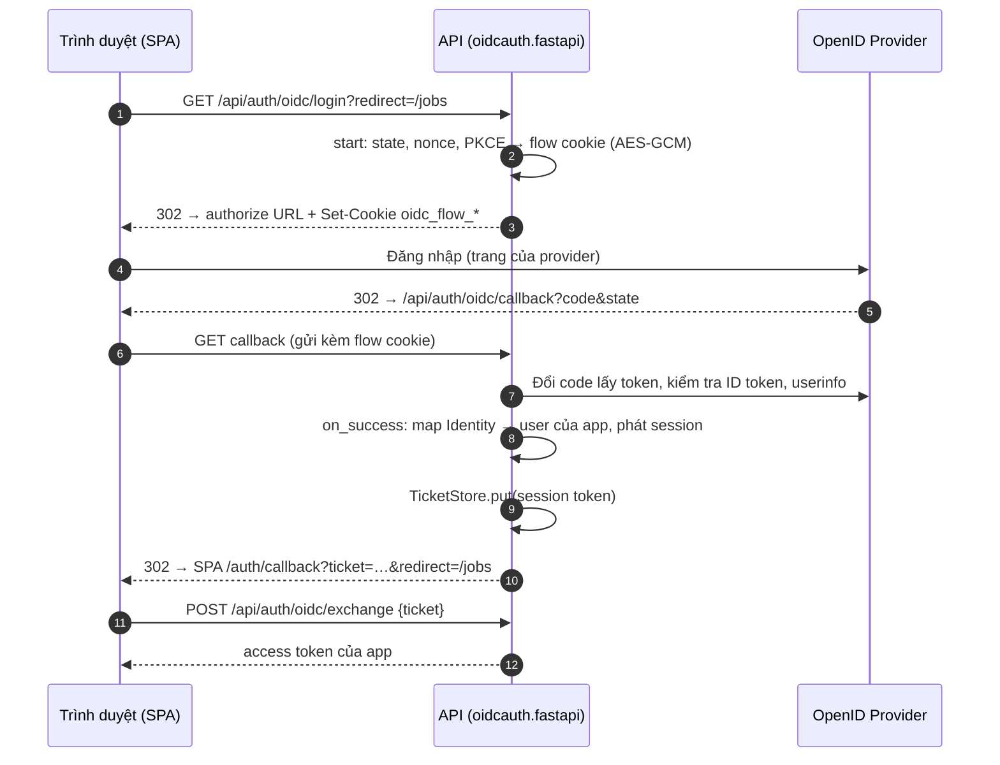

# Cài đặt và wiring

Tài liệu này dành cho người tích hợp `oidcauth` vào một service Python
(FastAPI / Starlette, async). Phần cấu hình phía provider (Zitadel...) nằm ở
[zitadel/](zitadel/README.md) và [providers.md](providers.md).

## 1. Luồng tổng quát



Thư viện lo bước 2–7 (và kiểm tra state/nonce/PKCE/chữ ký). App lo
`on_success`: tìm hoặc liên kết user, phát token theo cơ chế sẵn có, rồi trao
token cho SPA qua ticket dùng một lần (token không bao giờ nằm trên URL).

## 2. `Config` ↔ biến env

Cột "Biến env" là quy ước của backend template Python
(`templates/backend/python`), trùng tên với template Go; app khác có thể đặt
tên khác.

| Trường `oidcauth.Config` | Biến env (template) | Ghi chú |
|---|---|---|
| `issuer` | `AUTH_OIDC_ISSUER` | Phải trùng **chính xác** `issuer` trong `/.well-known/openid-configuration` (không có `/` cuối với Zitadel) |
| `discovery_url` | — | Chỉ khi discovery không nằm ở `<issuer>/.well-known/openid-configuration` |
| `client_id` | `AUTH_OIDC_CLIENT_ID` | |
| `client_secret` | `AUTH_OIDC_CLIENT_SECRET` | `client_secret_basic` (tự lùi về `client_secret_post` nếu provider chỉ hỗ trợ cái đó) |
| `client_key` + `client_key_id` | `AUTH_OIDC_CLIENT_KEY_FILE` | `private_key_jwt`. Template đọc file JSON key của Zitadel (`key`, `keyId`). Không dùng chung với `client_secret` |
| `token_endpoint_auth_method` | — | Mặc định `AUTH_METHOD_AUTO` (tự chọn); chỉ đặt khi cần ép một phương thức |
| `redirect_url` | `AUTH_OIDC_REDIRECT_URL` | URL tuyệt đối của callback, phải đăng ký ở provider |
| `scopes` | `AUTH_OIDC_SCOPES` | Mặc định `openid profile email`, cách nhau bởi dấu cách (trong `Config` là `list[str]`) |
| — (`LoginOptions.extra_scopes`) | `AUTH_OIDC_<KEY>_EXTRA_SCOPES` | Scope thêm cho một nút login, vd. `urn:zitadel:iam:org:id:<org>` |
| — (`LoginOptions.params`) | `AUTH_OIDC_<KEY>_PARAMS` | Tham số authorize thêm, dạng `k:v,k:v` (vd. `hd:example.com`) |
| `acr_values`, `require_acr`, `max_age` | — | Yêu cầu mức xác thực / đăng nhập lại (`max_age` là `timedelta`); xem README thư viện |
| `cookie_secret` | `AUTH_OIDC_COOKIE_SECRET` | ≥ 32 ký tự: `openssl rand -base64 32`. Đổi giá trị chỉ làm hỏng các login đang dở |
| `cookie_name` | — | Mặc định `oidc_flow` |
| `cookie_path` | — (template cố định `/api/auth/oidc/`) | Phải bao phủ path của callback. Mặc định `/` |
| `cookie_insecure` | `AUTH_OIDC_COOKIE_INSECURE` | `True` **chỉ** khi chạy HTTP thuần ở local |
| `flow_ttl` | — | `timedelta`, mặc định 10 phút: thời gian tối đa user đứng ở trang login |
| `skip_userinfo` | — | Mặc định gọi userinfo và gộp claim |
| `role_extractor` | — | Mặc định `default_role_extractor`: đọc role Zitadel, rồi `roles` / `groups` |
| `post_logout_redirect_url` | `AUTH_OIDC_POST_LOGOUT_REDIRECT_URL` | Template mặc định `${AUTH_FRONTEND_URL}/auth/login`; phải đăng ký ở provider |
| `http_client` | — | `httpx.AsyncClient` riêng: proxy, timeout, CA riêng. Mặc định client timeout 15 s |

Biến riêng của template (không thuộc `Config`):

| Biến | Ý nghĩa |
|---|---|
| `AUTH_LOCAL_ENABLED` | Bật login username/password. Tắt thì chỉ còn OIDC |
| `AUTH_FRONTEND_URL` | Origin của SPA, nơi callback redirect về |
| `AUTH_TICKET_TTL` | Thời hạn ticket SPA dùng để đổi token (mặc định `1m`) |
| `AUTH_OIDC_ENABLED` | Bật OIDC |
| `AUTH_OIDC_PROVIDER_NAME` | Chữ trên nút login, vd. `Viset ID` |
| `AUTH_OIDC_LINK_CLAIM`, `AUTH_OIDC_LINK_FIELD` | Liên kết lần đầu với user của app, xem [05 §3](zitadel/05-logout-and-linking.md#3-liên-kết-tài-khoản-với-user-của-app) |
| `AUTH_OIDC_PROVIDERS` | Danh sách key provider phụ (nút login thêm), cách nhau bởi dấu phẩy. Mỗi key đọc `AUTH_OIDC_<KEY>_*` |
| `AUTH_OIDC_<KEY>_VIA` | Dùng lại client của provider khác (`sso` = provider chính) |
| `AUTH_OIDC_<KEY>_IDP_ID` | Login Google... qua Zitadel không qua trang Zitadel, xem [04](zitadel/04-google-headless.md) |
| `AUTH_OIDC_<KEY>_REQUIRED_CLAIMS` | Claim bắt buộc khớp, dạng `k:v,k:v`; không dùng được với `VIA` |
| `AUTH_OIDC_SERVICE_TOKEN[_FILE]` | PAT của service account Zitadel, mặc định cho mọi provider có `IDP_ID`; `AUTH_OIDC_<KEY>_SERVICE_TOKEN[_FILE]` ghi đè |

Provider phụ đọc được cùng bộ trường với provider chính: `PROVIDER_NAME`,
`ISSUER`, `CLIENT_ID`, `CLIENT_SECRET`, `CLIENT_KEY_FILE`, `REDIRECT_URL`,
`POST_LOGOUT_REDIRECT_URL`, `SCOPES`, cộng thêm `VIA`, `IDP_ID`,
`EXTRA_SCOPES`, `PARAMS`, `REQUIRED_CLAIMS`, `SERVICE_TOKEN[_FILE]`.
`COOKIE_*` và `LINK_*` dùng chung. Provider chính (key `sso`) không được đặt
`VIA` hay `IDP_ID`; `IDP_ID` bắt buộc đi cùng `VIA`.

## 3. Cài và wiring với FastAPI

```bash
pip install "oidcauth-py[fastapi]"
# hoặc
uv add "oidcauth-py[fastapi]"
```

Extra `fastapi` chỉ kéo Starlette; `oidcauth.fastapi` chạy được với Starlette
thuần. Cần Python ≥ 3.10.

```python
import logging
from contextlib import asynccontextmanager
from datetime import timedelta
from urllib.parse import urlencode

from fastapi import FastAPI, Request
from fastapi.responses import RedirectResponse, Response

from oidcauth import (
    Client,
    Config,
    ConfigError,
    MemoryTicketStore,
    OIDCAuthError,
    Result,
    is_user_error,
    safe_return_to,
)
from oidcauth.fastapi import OIDCHandler

try:
    client = Client(
        Config(
            issuer=cfg.issuer,                  # AUTH_OIDC_ISSUER
            client_id=cfg.client_id,            # AUTH_OIDC_CLIENT_ID
            client_secret=cfg.client_secret,    # AUTH_OIDC_CLIENT_SECRET
            redirect_url=cfg.redirect_url,      # AUTH_OIDC_REDIRECT_URL
            cookie_secret=cfg.cookie_secret,    # AUTH_OIDC_COOKIE_SECRET
            cookie_insecure=cfg.cookie_insecure,  # AUTH_OIDC_COOKIE_INSECURE
            cookie_path="/api/auth/oidc/",
            post_logout_redirect_url=cfg.post_logout_redirect_url,
        )
    )
except ConfigError as e:
    raise SystemExit(f"oidc config: {e.errors}")  # thiếu trường, cookie_secret ngắn, ...

tickets = MemoryTicketStore()


@asynccontextmanager
async def lifespan(app: FastAPI):
    # Tuỳ chọn: tải discovery ngay để phát hiện issuer sai lúc khởi động.
    try:
        await client.init()
    except OIDCAuthError as e:
        logging.warning("oidc discovery: %s", e)
    yield
    await client.aclose()


async def on_success(request: Request, res: Result) -> Response:
    user = await users.from_identity(res.identity)  # chính sách của app
    if user is None:
        return RedirectResponse(frontend + "/auth/login?error=not_linked", 302)
    token = sessions.issue(user)
    ticket = await tickets.put(token, timedelta(minutes=1))
    query = urlencode({"ticket": ticket, "redirect": safe_return_to(res.return_to, "/")})
    return RedirectResponse(frontend + "/auth/callback?" + query, 302)


def on_error(request: Request, err: Exception) -> Response:
    code = "oidc_failed" if is_user_error(err) else "idp_unavailable"
    return RedirectResponse(frontend + "/auth/login?error=" + code, 302)


h = OIDCHandler(client, on_success=on_success, on_error=on_error)

app = FastAPI(lifespan=lifespan)
app.add_api_route("/api/auth/oidc/login", h.login, methods=["GET"])
# POST cho response_mode=form_post
app.add_api_route("/api/auth/oidc/callback", h.callback, methods=["GET", "POST"])
app.add_api_route("/api/auth/oidc/exchange", exchange_ticket, methods=["POST"])  # tickets.take(ticket) → token
```

- `Client(...)` chỉ kiểm tra config (lỗi → `ConfigError`, `.errors` liệt kê
  mọi lỗi). Discovery tải ở lần login đầu (rồi cache), hoặc ngay khi gọi
  `await client.init()` (dùng làm readiness check). Provider không truy cập
  được thì login trả lỗi `idp_unavailable`, service vẫn chạy.
- `?redirect=` chỉ nhận path cùng origin (`safe_return_to`), chống open
  redirect.
- `login_options(request)` trả `LoginOptions` cho từng lần login (scope thêm,
  `prompt`...). `return_to` do `login_options` đặt **thắng**; chỉ khi nó rỗng
  thì `return_to` mới lấy từ query `?redirect=` (tham số `return_to_param`).
  Dùng để làm sạch giá trị client gửi, hoặc đặt marker phía server (vd.
  `"link:<user id>"` cho luồng liên kết tài khoản, xem
  [05 §3.2](zitadel/05-logout-and-linking.md#32-liên-kết-thủ-công-từ-trang-profile)).
  Handler tự viết dùng lại quy tắc này qua
  `oidcauth.fastapi.start_options(request, login_options, return_to_param)`.
- `on_success`, `on_error`, `login_options` có thể là hàm thường hoặc
  coroutine. Không truyền `on_error` thì handler trả 401 (`login failed`) cho
  lỗi phía user và 502 (`identity provider unavailable`) cho lỗi provider.
- Không dùng FastAPI/Starlette? Gọi thẳng `await client.start(...)` (trả URL +
  `Cookie`) và `await client.finish(params, cookie_value)`, với
  `cookie_value` đọc theo tên `client.cookie_name_for(state)`; luôn đặt
  `client.clear_cookie(state)` lên response, dù thành công hay lỗi.

## 4. TicketStore

| Triển khai | Khi nào |
|---|---|
| `oidcauth.MemoryTicketStore()` | Một instance API duy nhất |
| `oidcauth.RedisTicketStore(redis)` (`SET … PX` + `GETDEL`) | Nhiều replica: callback và exchange có thể rơi vào hai pod khác nhau |

```python
from redis.asyncio import Redis

from oidcauth import RedisTicketStore, TicketNotFoundError

tickets = RedisTicketStore(Redis.from_url(redis_url), prefix="oidc:ticket:")

ticket = await tickets.put(token, timedelta(minutes=1))  # hoặc số giây
try:
    token = await tickets.take(ticket)  # dùng một lần
except TicketNotFoundError:
    ...  # ticket sai, hết hạn hoặc đã dùng
```

`RedisTicketStore` nhận mọi client tương thích `redis.asyncio.Redis` (cần
lệnh `GETDEL`, Redis ≥ 6.2); thư viện không tự cài `redis`. Muốn store khác
thì viết class có `async put(value, ttl) -> str` và `async take(ticket) -> str`
(raise `TicketNotFoundError` khi không có), `take` phải nguyên tử (get +
delete). Login Google không qua trang Zitadel
([04](zitadel/04-google-headless.md)) dùng chung store này.

## 5. Cookie

- Flow cookie tên `oidc_flow_<hash state>`, `HttpOnly`, `SameSite=Lax`,
  `Secure` (trừ khi `cookie_insecure`), sống `flow_ttl`. Mỗi lần login một
  cookie nên nhiều tab login song song không đè nhau.
- `cookie_path` phải là tiền tố của path callback. Template dùng
  `/api/auth/oidc/` để cookie đi theo mọi callback `/api/auth/oidc/*`.
- Login và callback phải cùng **host** API (cookie gắn với host). Nếu login ở
  `localhost:8000` mà `REDIRECT_URL` là `127.0.0.1:8000` thì callback báo
  `state_expired`.
- `response_mode=form_post`: provider POST callback cross-site, nên cookie của
  lượt login đó tự chuyển sang `SameSite=None; Secure` (cần HTTPS). Nhớ mount
  callback cả `POST`.

## 6. Chạy local

1. Tạo application ở provider với redirect URI
   `http://localhost:8000/api/auth/oidc/callback` (Zitadel: bật
   **Development Mode** để chấp nhận `http://`, xem
   [01](zitadel/01-web-app.md#bước-5-redirect-uris)).
2. `.env`:

   ```dotenv
   AUTH_FRONTEND_URL=http://localhost:3000
   AUTH_OIDC_ENABLED=true
   AUTH_OIDC_ISSUER=https://id.example.com
   AUTH_OIDC_CLIENT_ID=<client id>
   AUTH_OIDC_CLIENT_SECRET=<client secret>
   AUTH_OIDC_REDIRECT_URL=http://localhost:8000/api/auth/oidc/callback
   AUTH_OIDC_COOKIE_SECRET=<openssl rand -base64 32>
   AUTH_OIDC_COOKIE_INSECURE=true
   ```

3. Khởi động lại API (đọc env lúc start), mở `http://localhost:3000/auth/login`.
4. Kiểm tra nhanh: `GET http://localhost:8000/api/auth/options` liệt kê các nút
   login đã bật (route của backend template).

## 7. Checklist production

- [ ] `AUTH_OIDC_REDIRECT_URL`, `AUTH_OIDC_POST_LOGOUT_REDIRECT_URL` là HTTPS và
      đã đăng ký đúng từng ký tự ở provider.
- [ ] Zitadel: tắt **Development Mode** của application.
- [ ] `AUTH_OIDC_COOKIE_INSECURE=false`.
- [ ] `AUTH_OIDC_COOKIE_SECRET` sinh ngẫu nhiên, lưu như secret, giống nhau
      giữa các replica / worker.
- [ ] Nhiều replica (hoặc nhiều worker uvicorn/gunicorn): `TicketStore` dùng
      Redis. `MemoryTicketStore` nằm trong bộ nhớ của từng process.
- [ ] Client secret / key file / PAT nằm trong secret store, không commit.
- [ ] Đăng ký Back-Channel Logout URI nếu muốn đăng xuất đồng bộ.
- [ ] Thử từng mã lỗi ở [troubleshooting](zitadel/troubleshooting.md) mà trang
      login của SPA cần hiển thị.
