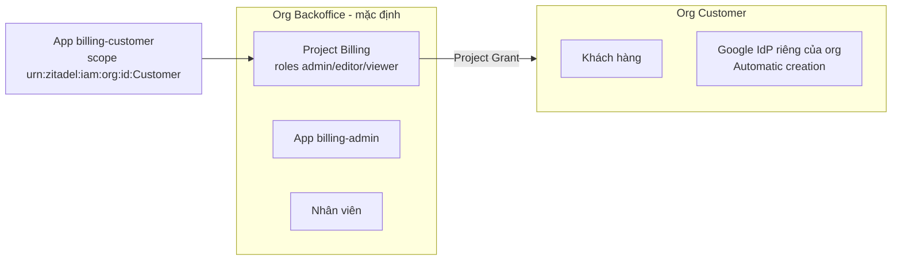

# 02. Role, chặn user không có quyền, organization

Làm sau [01](01-web-app.md). Mỗi mục độc lập, chọn mục cần.

## 1. Role trong token

Kết quả: `res.identity.roles` chứa role của user trong project (vd.
`["admin"]`).

### 1.1 Tạo role

1. **Projects** → project của app → sidenav **Roles** → **Create Role**
   (hoặc **New**).
2. Nhập:
   - **Key**: mã role app sẽ đọc, vd. `admin`, `editor`, `viewer`.
   - **Display Name**: tên hiển thị.
   - **Group**: tuỳ chọn, để nhóm role trong console.
3. **Save**. Lặp lại cho từng role.

### 1.2 Bật trả role khi đăng nhập

1. Project → sidenav **General**.
2. Tick **Return user roles during authentication**.
3. **Save**.

Thư viện gọi userinfo sau khi đổi code, nên role có ngay mà **không** cần bật
**User roles inside ID Token** ở **Token Settings** của application. Chỉ bật
nó nếu app đặt `Config(skip_userinfo=True)`.

### 1.3 Gán role cho user

1. Menu **Role Assignments** → **New** (hộp thoại **Create Role
   Assignment**).
2. Chọn user (tìm theo tên / email) → chọn project → tick role → **Save**.

Hoặc từ **Users** → user → mục **Role Assignments** → **New**.

### 1.4 Dùng role trong app

```python
async def on_success(request: Request, res: Result) -> Response:
    if not res.identity.has_role("admin"):
        ...
```

`default_role_extractor` đọc `urn:zitadel:iam:org:project:roles` và
`urn:zitadel:iam:org:project:<projectId>:roles`. Zitadel trả role dạng
`{"admin": {"<orgId>": "<org domain>"}}`: user có role nào ở org nào. Cần
biết org thì đọc `res.identity.claims` trực tiếp.

> Backend template chưa map role Zitadel sang role của app: role trong app vẫn
> quản lý ở app. Muốn đồng bộ thì viết thêm trong `on_success`.

## 2. Chặn user không có quyền vào app

Mặc định mọi user của instance đăng nhập được mọi app. Hai checkbox ở
project → **General**:

| Checkbox | Tác dụng | Lỗi app nhận |
|---|---|---|
| **Only authorized users can authenticate** | User phải có ít nhất một role assignment trong project | `access_denied` |
| **Authentication is restricted to users from organizations that have been granted access to this project** | Org của user phải là org sở hữu project hoặc được **Project Grant** | `access_denied` |

Tick → **Save**.

Với login qua trang Zitadel, Zitadel chặn ở trang login của nó (hiện thông
báo lỗi) hoặc trả về callback với `error=access_denied`, tuỳ phiên bản login
UI; template hiển thị mã lỗi provider trả về. Với login không qua trang
Zitadel ([04](04-google-headless.md)), lỗi luôn về app với mã `access_denied`.

## 3. Ghim login vào một organization

Kết quả: chỉ user thuộc org đó đăng nhập được; trang login Zitadel hiển thị
branding và IdP của org đó; user mới (đăng ký hoặc auto-create) được tạo vào
org đó.

1. **Organization** (chọn đúng org) → copy **Organization ID**.
2. Thêm scope `urn:zitadel:iam:org:id:<Organization ID>`:

   - Cho **mọi** login của app:

     ```dotenv
     AUTH_OIDC_SCOPES="openid profile email urn:zitadel:iam:org:id:<org id>"
     ```

   - Chỉ cho **một nút** login (provider phụ dùng lại client chính):

     ```dotenv
     AUTH_OIDC_PROVIDERS=customer
     AUTH_OIDC_CUSTOMER_VIA=sso
     AUTH_OIDC_CUSTOMER_PROVIDER_NAME=Khách hàng
     AUTH_OIDC_CUSTOMER_EXTRA_SCOPES=urn:zitadel:iam:org:id:<org id>
     ```

   - Tự wiring:

     ```python
     OIDCHandler(
         client,
         login_options=lambda request: LoginOptions(
             extra_scopes=["urn:zitadel:iam:org:id:" + org_id]
         ),
         on_success=on_success,
     )
     ```

3. Nếu org này **không** sở hữu project, phải cấp project cho nó (mục 4.2),
   nếu không user nhận `access_denied` (khi đã bật checkbox thứ hai ở mục 2).

Có thể dùng `urn:zitadel:iam:org:domain:primary:<domain>` thay cho ID.

## 4. Mô hình 2 organization (nội bộ / khách hàng)



- App nội bộ: không ghim org hoặc ghim org Backoffice.
- App khách: ghim org Customer (mục 3), người lạ đăng nhập Google được
  tạo tài khoản trong Customer, không lẫn với nhân viên.

### 4.1 Tạo org khách

1. **Default settings** → **Organizations** (hoặc ô chọn org → **New
   Organization**) → nhập tên `Customer` → tạo.
2. Chọn org vừa tạo → copy **Organization ID**.

### 4.2 Cấp project cho org khách (Project Grant)

1. Chọn org **sở hữu** project → **Projects** → project → sidenav **Project
   Grants** → **New**.
2. Chọn org `Customer` → tick các role org khách được dùng (vd. `viewer`) →
   **Save**.
3. Từ giờ admin của org Customer gán các role này cho user của họ ở **Role
   Assignments** (project hiện dưới dạng "Granted Project").

### 4.3 Login ở org khách

Đặt cấu hình riêng cho org Customer: chọn org Customer → **Settings** →
**Login Behavior and Security** và **Identity Providers**. Hướng dẫn IdP
Google cho org ở [03](03-google-zitadel-login.md#3-thêm-google-vào-zitadel).

Ví dụ Viset (`id.viset.vn`):

| | Giá trị |
|---|---|
| Org Backoffice (mặc định) | `396542286881686787` |
| Org Customer | `396609405828726786` |
| App khách gửi scope | `urn:zitadel:iam:org:id:396609405828726786` |
| Google cấp instance | Auto-link theo email, không auto-create; **set as not available** trong Customer |
| Google riêng của Customer | **Automatic creation** bật |
