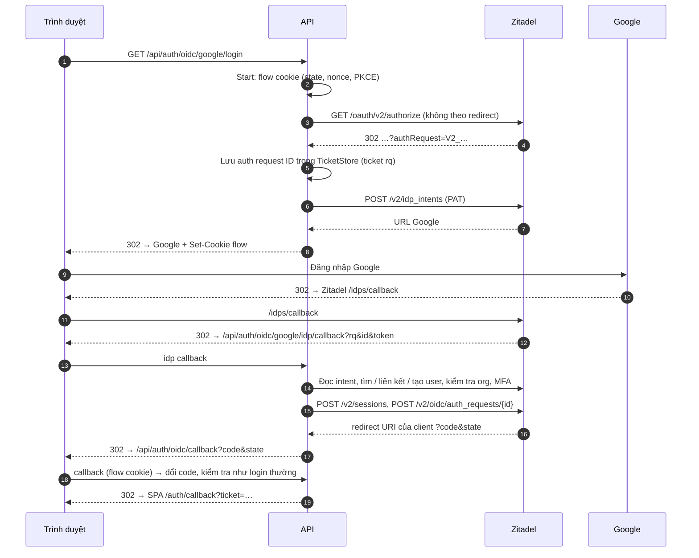
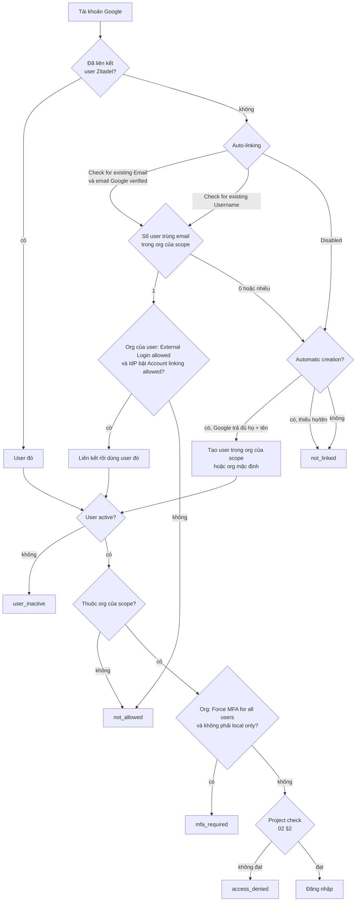

# 04. Google qua Zitadel, không qua trang Zitadel (`IDP_ID`)

Kết quả: nút "Đăng nhập bằng Google"; trình duyệt chỉ thấy trang Google. User
trong app vẫn là **user Zitadel** (role, back-channel logout, project check
như [01](01-web-app.md)/[02](02-roles-and-orgs.md)).

Cách làm: API tự đóng vai trang login của Zitadel qua API v2 (giống Login
V2), bằng một service account có role instance `IAM_LOGIN_CLIENT`.

Cần làm trước: [01](01-web-app.md), và [03 §1–§3](03-google-zitadel-login.md)
(OAuth client Google + IdP Google trong Zitadel, đã **Activate**).

## 1. Luồng



## 2. Tạo service account và PAT

Làm một lần cho mỗi instance; mọi app dùng chung được (hoặc mỗi app một
account để thu hồi riêng).

1. Chọn org nội bộ (vd. org mặc định) → menu **Users** → tab **Service
   Accounts** → **New**.
2. Điền:
   - **User Name**: vd. `login-client-billing`.
   - **Name**: vd. `Login client Billing`.
   - **Description**: tuỳ.
   - **Access Token Type**: **Bearer**.
3. **Create**. Trang của service account mở ra.
4. Mục **Personal Access Tokens** → **New** → hộp thoại **Generate new
   Personal Access Token**: chọn ngày hết hạn (tuỳ, nhớ lịch xoay vòng) →
   tạo.
5. Hộp thoại "Make sure to copy your personal access token. You won't be able
   to see it again!" → copy token → lưu vào secret store.

## 3. Gán role instance `IAM_LOGIN_CLIENT`

Role này cho phép tạo session và hoàn tất auth request thay trang login.
Role org hay project **không** đủ.

1. **Default settings** (trang Instance) → khung **Administrators** → nút
   **(+)**.
2. Hộp thoại **Add an Administrator**: tìm service account ở §2.
3. Tick role **IAM_LOGIN_CLIENT** ("Has permission to manage login
   applications") → **Add** / **Save**.

Kiểm tra: khung **Administrators** có service account với role
`IAM_LOGIN_CLIENT`.

## 4. Biến env

```dotenv
# Provider chính (01) giữ nguyên.

# PAT ở §2. Dùng _FILE nếu secret được mount thành file.
AUTH_OIDC_SERVICE_TOKEN=<PAT>
# AUTH_OIDC_SERVICE_TOKEN_FILE=/run/secrets/zitadel-login-pat

AUTH_OIDC_PROVIDERS=google
AUTH_OIDC_GOOGLE_PROVIDER_NAME=Google
AUTH_OIDC_GOOGLE_VIA=sso                       # dùng client của provider chính
AUTH_OIDC_GOOGLE_IDP_ID=<Identity Provider ID> # 03 §3 bước 6
AUTH_OIDC_GOOGLE_EXTRA_SCOPES=urn:zitadel:iam:org:id:<Organization ID>
```

| Biến | Bắt buộc | Ghi chú |
|---|---|---|
| `AUTH_OIDC_SERVICE_TOKEN[_FILE]` | Có (hoặc `AUTH_OIDC_GOOGLE_SERVICE_TOKEN[_FILE]`) | Thiếu thì API lỗi lúc khởi động |
| `AUTH_OIDC_GOOGLE_VIA` | Có | `IDP_ID` luôn đi cùng `VIA` |
| `AUTH_OIDC_GOOGLE_IDP_ID` | Có | ID của IdP Google trong Zitadel |
| `AUTH_OIDC_GOOGLE_EXTRA_SCOPES` | Nên có | Org mà user được tìm / tạo. Phải là org sở hữu IdP, hoặc org đang bật IdP cấp instance |

**Không** đăng ký thêm redirect URI nào ở Zitadel hay Google:

- Zitadel tự quay về `https://<api>/api/auth/oidc/google/idp/callback` (API
  truyền URL này khi tạo intent; host lấy từ `AUTH_OIDC_REDIRECT_URL`).
- Code cuối cùng vẫn về `AUTH_OIDC_REDIRECT_URL` của provider chính.

Khởi động lại API.

Tự wiring:

```python
import os

from oidcauth import LoginOptions
from oidcauth import zitadel
from oidcauth.zitadel.fastapi import ZitadelIDPHandler

api = zitadel.Client(client.config.issuer, os.environ["ZITADEL_LOGIN_PAT"])
google = ZitadelIDPHandler(
    client,
    zitadel.IDPLogin(api, google_idp_id),
    tickets=tickets,  # dùng chung TicketStore với ticket login được
    callback_url="https://api.example.com/api/auth/oidc/google/idp/callback",
    login_options=lambda request: LoginOptions(
        extra_scopes=["urn:zitadel:iam:org:id:" + org_id]
    ),
    on_error=on_error,  # map lỗi, xem §6
)
app.add_api_route("/api/auth/oidc/google/login", google.login, methods=["GET"])
app.add_api_route("/api/auth/oidc/google/idp/callback", google.callback, methods=["GET"])
# /api/auth/oidc/callback vẫn là OIDCHandler.callback của client
```

Ticket `rq` sống bằng `flow_ttl` của client và có tiền tố `zitadel-idp:`
trong store. `return_to` theo cùng quy tắc với `OIDCHandler`: `return_to` do
`login_options` đặt thắng, rỗng thì lấy `?redirect=`.

`cookie_path` của client phải bao cả `/api/auth/oidc/google/idp/callback` và
`/api/auth/oidc/callback` (vd. `/api/auth/oidc/`).

## 5. Ai đăng nhập được

API làm giống trang login của Zitadel, theo tuỳ chọn của IdP (03 §2):



Lưu ý:

- Không có scope org, một email trùng ở **nhiều** org bị từ chối (liên kết
  sẽ là đoán) và user mới được tạo ở **org mặc định**. Hãy luôn đặt
  `EXTRA_SCOPES` org.
- Auto-link theo email chỉ khi Google báo email **verified** (Gmail luôn
  verified).

### 5.1 MFA

Trang login của Zitadel hỏi được mã MFA, API thì không. Nếu org của user bật
**Force MFA for all users**, login Google qua `IDP_ID` trả `mfa_required`.

Cách xử lý (org → **Settings** → **Login Behavior and Security**):

- Chọn **Force MFA for local authenticated users only**: user mật khẩu vẫn bị
  ép MFA, user đăng nhập bằng Google thì không (Google đã có xác thực của
  nó). **Save**.
- Hoặc dùng [03](03-google-zitadel-login.md) (có trang Zitadel) cho org cần
  MFA cho cả user Google.

## 6. Mã lỗi (template)

| Lỗi thư viện | Mã trên `/auth/login?error=` | Nguyên nhân thường gặp |
|---|---|---|
| `zitadel.NotLinkedError` | `not_linked` | Không có user, IdP không auto-link / auto-create, hoặc thiếu họ/tên khi auto-create, hoặc email trùng nhiều org |
| `zitadel.NotAllowedError` | `not_allowed` | User ở org khác scope, org tắt **External Login allowed**, IdP không bật cho org / không cho linking |
| `zitadel.AccessDeniedError` | `access_denied` | Project check (02 §2) |
| `zitadel.UserInactiveError` | `user_inactive` | User Zitadel bị deactivate / lock |
| `zitadel.MFARequiredError` | `mfa_required` | §5.1 |
| `zitadel.AuthRequestExpiredError`, `oidcauth.InvalidStateError` | `state_expired` | Đứng ở trang Google quá `flow_ttl` (10 phút), ấn Back / mở lại link cũ |
| `zitadel.IntentFailedError` | `oidc_failed` | User huỷ ở Google |
| `zitadel.APIError` 4xx khác (`.status`) | `oidc_failed` | Thường là PAT thiếu `IAM_LOGIN_CLIENT` (403) hoặc PAT hết hạn (401) |
| Lỗi mạng (`zitadel.ZitadelError`) / `APIError` 5xx | `idp_unavailable` | Zitadel không truy cập được |

Kiểm tra bằng `isinstance` (mọi lỗi từ chối là lớp con của
`zitadel.LoginError`, `.detail` giữ lý do); `zitadel.is_user_error(err)` trả
`True` cho `LoginError` và `APIError` 4xx:

```python
import oidcauth
from oidcauth import zitadel


def on_error(request: Request, err: Exception) -> Response:
    if isinstance(err, zitadel.NotLinkedError):
        code = "not_linked"
    elif isinstance(err, zitadel.MFARequiredError):
        code = "mfa_required"
    # ... các lớp khác theo bảng trên
    elif zitadel.is_user_error(err) or oidcauth.is_user_error(err):
        code = "oidc_failed"
    else:
        code = "idp_unavailable"
    return RedirectResponse(frontend + "/auth/login?error=" + code, 302)
```

Log API ghi lý do chi tiết (`zitadel idp login refused` kèm `reason`).

## 7. Thử

1. Trang login SPA → **Google** → chỉ thấy trang Google → quay về app đã đăng
   nhập.
2. Console Zitadel → **Users** → user đó → mục identity providers có Google;
   mục sessions có session mới.
3. Thử các ca từ chối: tài khoản Google không có user (khi tắt auto-create)
   → `not_linked`; user bị **Deactivate** → `user_inactive`.

## 8. Vì sao không đăng ký app làm "Custom base URL for the new Login UI"?

Zitadel cho mỗi application một **Custom base URL for the new Login UI**,
nhưng khi instance bật Login V2 bắt buộc (**Default settings** →
**Features** → Login V2) thì URL theo app bị bỏ qua. Vì vậy API tự gọi
authorize phía server, lấy `authRequest=V2_…` rồi xử lý như một login UI.
