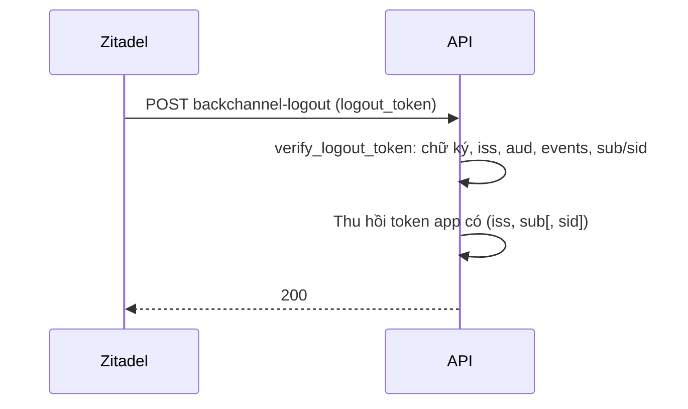

# 05. Đăng xuất và liên kết tài khoản

## 1. Đăng xuất từ app (RP-initiated logout)

Kết quả: user bấm "Đăng xuất" trong app → kết thúc session ở cả app và
Zitadel → quay về trang login của app.

### Zitadel

1. **Projects** → project → application → **Redirect Settings**.
2. **Post Logout URIs**: thêm `https://app.example.com/auth/login`
   (local `http://localhost:3000/auth/login`) → **Save**.

### Env

```dotenv
AUTH_OIDC_POST_LOGOUT_REDIRECT_URL=https://app.example.com/auth/login
# để trống: mặc định ${AUTH_FRONTEND_URL}/auth/login
```

### Cách chạy (template)

1. Sau login, API trả `logout_url` cùng access token (`POST
   /api/auth/oidc/exchange`): đó là `end_session_endpoint` của Zitadel kèm
   `id_token_hint` và `post_logout_redirect_uri`.
2. SPA lưu `logout_url`. Khi đăng xuất: xoá token của app rồi chuyển trình
   duyệt tới `logout_url`.
3. Zitadel kết thúc session, đưa về **Post Logout URIs**.

Tự wiring:

```python
from oidcauth import NotSupportedError

try:
    url = await client.logout_url(
        id_token_hint=identity.tokens.id_token,
        post_logout_redirect=post_logout_url,  # rỗng: dùng Config.post_logout_redirect_url
        state=state,
    )
except NotSupportedError:
    url = None  # provider không có end_session_endpoint: chỉ đăng xuất app
```

Provider không có `end_session_endpoint` (vd. Google) raise
`oidcauth.NotSupportedError`: khi đó chỉ đăng xuất app.

## 2. Back-channel logout

Kết quả: user đăng xuất ở Zitadel (ở app khác, ở console, hoặc admin kết thúc
session) → Zitadel gọi API → API thu hồi token app của session đó.

### Zitadel

1. **Projects** → project → application → sidenav **Settings** → khung
   **OIDC Settings**.
2. **Back-Channel Logout URI**: `https://api.example.com/api/auth/oidc/backchannel-logout`.
3. **Save**.

Zitadel v4 luôn bật back-channel logout (feature flag cũ đã bỏ). URI phải
truy cập được **từ server Zitadel** (không dùng `localhost` trừ khi Zitadel
chạy cùng máy).

### Env

Không có biến mới. Route `POST /api/auth/oidc/backchannel-logout` luôn được
đăng ký khi bật OIDC (mỗi provider có client riêng có route của nó:
`/api/auth/oidc/<key>/backchannel-logout`).

### Cách chạy



Token app ghi `sid` (`identity.session_id`) lúc login, nên chỉ session tương
ứng bị thu hồi. Tự wiring: `OIDCHandler.backchannel_logout(on_logout)`,
`on_logout(request, token)` (sync hoặc async) nhận `oidcauth.LogoutToken`
(`issuer`, `subject`, `session_id`, `jwt_id`, `expiry`):

```python
from oidcauth import LogoutToken


async def on_logout(request: Request, token: LogoutToken) -> None:
    await sessions.revoke(token.issuer, token.subject, token.session_id)


app.add_api_route(
    "/api/auth/oidc/backchannel-logout",
    h.backchannel_logout(on_logout),
    methods=["POST"],
)
```

Route trả `200` khi thành công, `400 invalid_request` khi logout token không
hợp lệ, `502 temporarily_unavailable` khi không tải được key của provider,
`501 logout_failed` khi `on_logout` raise lỗi. Không dùng FastAPI thì gọi
thẳng `await client.verify_logout_token(raw)` (raise
`InvalidLogoutTokenError`).

Kiểm tra: đăng nhập app → console Zitadel → **Users** → user → sessions →
xoá session (hoặc đăng xuất ở app khác cùng Zitadel) → gọi API bằng token
cũ → 401.

## 3. Liên kết tài khoản với user của app

`oidcauth` không tạo hay chọn user của app; app quyết định. Template lưu bảng
`user_identities` với khoá `(issuer, subject)` và có hai cách liên kết.

### 3.1 Tự liên kết ở lần đăng nhập đầu

| Biến | Ý nghĩa |
|---|---|
| `AUTH_OIDC_LINK_CLAIM` | Claim của provider để so khớp: `email` (mặc định), `preferred_username`, `sub`, `phone_number` hoặc claim tuỳ ý |
| `AUTH_OIDC_LINK_FIELD` | Trường của user app để so: `email` (mặc định) hoặc `username` |

- `email` / `phone_number` chỉ dùng khi provider báo **verified**.
- Đặt `AUTH_OIDC_LINK_CLAIM=` (rỗng) để tắt tự liên kết: chỉ liên kết thủ công.
- Không tìm thấy user → `not_linked`. User app bị khoá → `user_inactive`.
- Template **không** tự tạo user app mới. Muốn tạo (vd. app khách hàng) thì
  sửa `OIDCAuthService.login_with_identity` trong
  `templates/backend/python/app/core/security/oidc/service.py` (chỗ map
  `Identity` → user app, được `on_success` ở `handler.py` cùng thư mục gọi).

Ví dụ:

```dotenv
# Nhân viên: user app có email trùng email Zitadel (verified)
AUTH_OIDC_LINK_CLAIM=email
AUTH_OIDC_LINK_FIELD=email

# Username app trùng username đăng nhập Zitadel
AUTH_OIDC_LINK_CLAIM=preferred_username
AUTH_OIDC_LINK_FIELD=username
```

### 3.2 Liên kết thủ công từ trang profile

1. User đăng nhập app (bằng mật khẩu hoặc provider khác).
2. Trang **Profile** → khung tài khoản liên kết → nút của provider (vd.
   **Google**).
3. Đăng nhập ở provider (luôn hiện chọn tài khoản) → quay về Profile, tài
   khoản được liên kết.

Tự wiring: user nào đang liên kết phải do server quyết định, không lấy từ
query. `login_options` đặt marker phía server vào `return_to`; `return_to` do
`login_options` đặt **thắng** `?redirect=` của client (giống `oidcfiber` bản
Go, nơi `LoginOptions` áp sau `WithReturnTo`). `on_success` nhận lại marker
qua `res.return_to`:

```python
from oidcauth import LoginOptions, PROMPT_SELECT_ACCOUNT, Result


async def link_options(request: Request) -> LoginOptions:
    user = await current_user(request)  # user app đang đăng nhập (session app)
    return LoginOptions(return_to="link:" + str(user.id), prompt=[PROMPT_SELECT_ACCOUNT])


async def on_link_success(request: Request, res: Result) -> Response:
    if res.return_to.startswith("link:"):
        user_id = res.return_to.removeprefix("link:")
        await identities.link(user_id, res.identity.issuer, res.identity.subject)
        return RedirectResponse(frontend + "/profile", 302)
    ...  # login thường


link = OIDCHandler(client, login_options=link_options, on_success=on_link_success)
```

Handler tự viết (không dùng `OIDCHandler`) áp cùng quy tắc bằng
`oidcauth.fastapi.start_options(request, login_options, return_to_param)`.
`ZitadelIDPHandler` ([04](04-google-headless.md)) cũng theo quy tắc này.

Lỗi hiện ở `/profile?link_error=<code>`:

| Mã | Nghĩa |
|---|---|
| `identity_in_use` | Tài khoản provider đã liên kết với user app khác |
| `already_linked` | User này đã liên kết một tài khoản khác của cùng provider |
| `not_allowed` | Không đạt `REQUIRED_CLAIMS` |
| các mã login khác | Như [troubleshooting](troubleshooting.md) |

Gỡ liên kết: nút gỡ ở Profile (`DELETE /api/profile/identities/:id`). Không
gỡ được phương thức đăng nhập cuối cùng khi `AUTH_LOCAL_ENABLED=false`.

### 3.3 Lưu ý về issuer

Nút qua Zitadel (01, 03, 04) đều cho identity có issuer Zitadel và subject là
ID user Zitadel: liên kết một lần là dùng được cả nút Zitadel lẫn nút Google
qua Zitadel. Google trực tiếp ([providers.md](../providers.md)) có issuer
`https://accounts.google.com`, là một identity khác, liên kết riêng.
