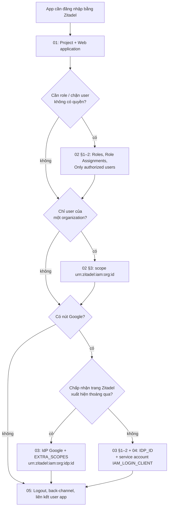

# Tích hợp với Zitadel

Hướng dẫn cho Zitadel v4 (console mới, `/ui/console`). Nhãn giao diện giữ
nguyên tiếng Anh như console hiển thị.

## 0. Chuẩn bị

Bạn cần một tài khoản Zitadel có quyền:

| Việc | Quyền tối thiểu |
|---|---|
| Tạo project, application, role | `ORG_OWNER` của organization chứa project (hoặc `PROJECT_OWNER` cho project có sẵn) |
| Thêm IdP Google cho một organization | `ORG_OWNER` của organization đó |
| Thêm IdP Google cấp instance, gán role instance cho service account | `IAM_OWNER` |

Không có quyền thì nhờ quản trị Zitadel làm các bước tương ứng và gửi lại cho
bạn: client ID, client secret (hoặc file key), Organization ID, Identity
Provider ID, PAT.

### 0.1 Đăng nhập console

1. Mở `https://<zitadel>/ui/console` (vd. `https://id.example.com/ui/console`).
2. Đăng nhập bằng tài khoản quản trị.

### 0.2 Bản đồ console

```text
Thanh trên cùng
├─ [Default settings]        → trang Instance: cấu hình chung cho mọi org
│     ├─ Administrators (+)    (gán role instance, vd. IAM_LOGIN_CLIENT)
│     ├─ Identity Providers    (IdP cấp instance)
│     ├─ Login Behavior and Security
│     └─ Organizations
├─ [Organization] (chọn org ở ô chọn org cạnh logo)
│     ├─ Organization ID
│     ├─ Identity Providers    (IdP riêng của org)
│     └─ Login Behavior and Security (ghi đè cấu hình instance)
└─ Menu: Home · Organization · Projects · Users · Role Assignments · Actions · Settings
```

> Mọi thao tác ở **Projects**, **Users**, **Role Assignments** áp dụng cho
> organization đang chọn. Luôn kiểm tra tên org ở góc trên trái trước khi tạo.

### 0.3 Lấy các giá trị dùng chung

| Giá trị | Lấy ở đâu | Đặt vào |
|---|---|---|
| Issuer | `https://<zitadel>` (đúng như `issuer` ở `https://<zitadel>/.well-known/openid-configuration`, không có `/` cuối) | `AUTH_OIDC_ISSUER` |
| Organization ID | **Organization** → dòng **Organization ID** (nút copy bên cạnh) | Scope `urn:zitadel:iam:org:id:<id>` |
| Project ID | **Projects** → project → dòng **Project ID** | Scope `urn:zitadel:iam:org:project:id:<id>:aud` (hiếm khi cần) |
| Identity Provider ID | Trang chi tiết IdP → **Identity Provider ID**, hoặc phần cuối URL `/instance/provider/google/<id>` / `/org/provider/google/<id>` | `AUTH_OIDC_<KEY>_IDP_ID` |

Kiểm tra issuer:

```bash
curl -s https://id.example.com/.well-known/openid-configuration | jq -r .issuer
```

## 1. Chọn trường hợp



| # | Tài liệu | Kết quả |
|---|---|---|
| 1 | [01-web-app.md](01-web-app.md) | Nút "Đăng nhập bằng `<Zitadel>`" chạy được |
| 2 | [02-roles-and-orgs.md](02-roles-and-orgs.md) | Role trong token, chặn user ngoài, ghim org, 2 org nội bộ/khách |
| 3 | [03-google-zitadel-login.md](03-google-zitadel-login.md) | Nút Google, có trang Zitadel ở giữa (không cần service account) |
| 4 | [04-google-headless.md](04-google-headless.md) | Nút Google, trình duyệt chỉ thấy trang Google |
| 5 | [05-logout-and-linking.md](05-logout-and-linking.md) | Đăng xuất đồng bộ; map user Zitadel ↔ user app |
| — | [troubleshooting.md](troubleshooting.md) | Tra mã lỗi |

So sánh ba cách cho nút Google:

| | 03: qua trang Zitadel | 04: không qua trang Zitadel (`IDP_ID`) | Google trực tiếp ([providers.md](../providers.md#1-google-trực-tiếp-không-qua-zitadel)) |
|---|---|---|---|
| User trong app là | User Zitadel | User Zitadel | Tài khoản Google |
| Role Zitadel, back-channel logout | Có | Có | Không |
| Trình duyệt thấy | Google + Zitadel (redirect, đôi khi một trang) | Chỉ Google | Chỉ Google |
| Service account | Không | Có (`IAM_LOGIN_CLIENT` + PAT) | Không |
| MFA bắt buộc cho user Google | Zitadel hỏi được | Không hỏi được → `mfa_required` | Không áp dụng |
| Tạo user mới khi lần đầu login | Theo IdP options, Zitadel có thể hiện form | Theo IdP options, cần Google trả đủ họ và tên | App tự quyết |
